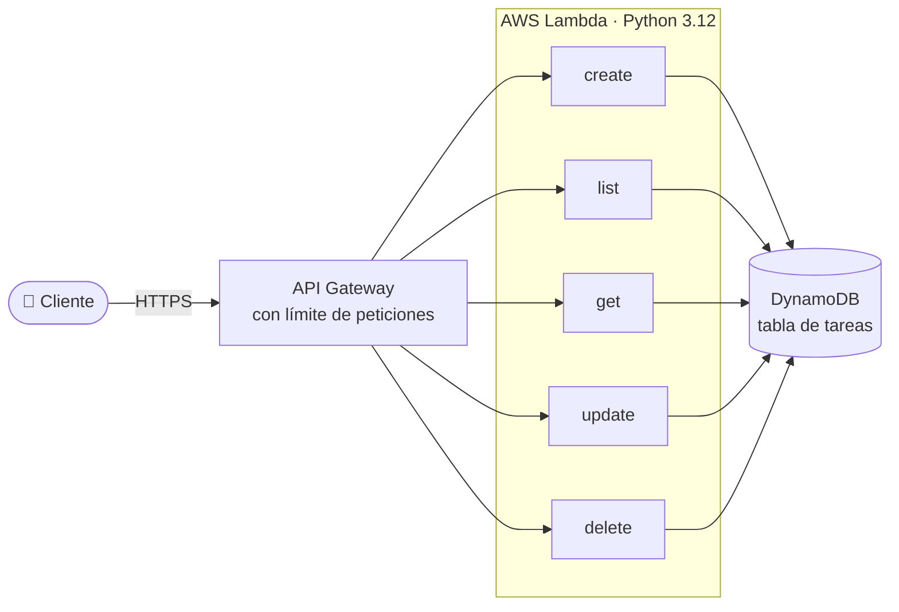
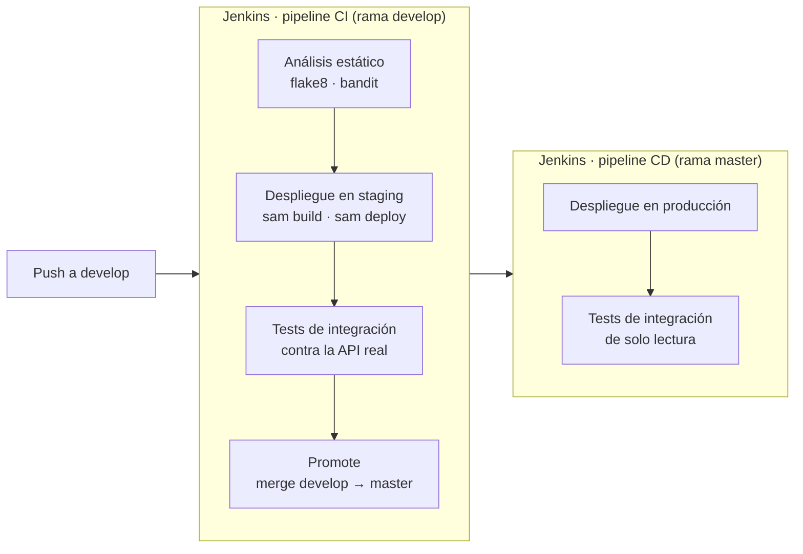

<h1 align="center">API serverless en AWS con CI/CD</h1>

<p align="center">
  API REST de lista de tareas construida con <b>AWS Lambda</b>, <b>API Gateway</b> y <b>DynamoDB</b>,<br/>
  desplegada automáticamente en staging y producción con <b>Jenkins</b> y <b>AWS SAM</b>.
</p>

<p align="center">
  <a href="https://github.com/sergioglezz/demo-aws-serverless-cicd/actions/workflows/ci.yml"></a>
  
  
  
  
  
</p>

---

## Resumen

Una API para crear, consultar, modificar y borrar tareas, que funciona **sin servidores que administrar**: cada operación es una función Lambda y los datos se guardan en DynamoDB.

Lo interesante del proyecto es el **ciclo de entrega completo**:

- Cada cambio en `develop` se analiza, se despliega en **staging** y se prueba contra la API real.
- Si todo pasa, Jenkins lo fusiona en `master` y lo despliega en **producción**.
- Toda la infraestructura (API, funciones, tabla y permisos) está definida como código en una plantilla de AWS SAM.

> **English:** Serverless TODO REST API on AWS (API Gateway, Lambda, DynamoDB) defined with AWS SAM. Jenkins pipelines run static analysis, deploy to staging, run integration tests against the live API and promote to production automatically. GitHub Actions adds linting, security scanning and unit tests on every push.

*Proyecto desarrollado en la asignatura DevOps & Cloud de UNIR, a partir de la plantilla `todo-list-aws` del curso.*

---

## Arquitectura



Hay un entorno de **staging** y otro de **producción**, cada uno con su propia API, funciones y tabla (`staging-TodosDynamoDbTable` y `production-TodosDynamoDbTable`).

---

## La API

| Método | Ruta | Qué hace | Respuesta |
|---|---|---|---|
| `POST` | `/todos` | Crea una tarea | `201` con la tarea creada |
| `GET` | `/todos` | Lista todas las tareas | `200` con la lista |
| `GET` | `/todos/{id}` | Consulta una tarea | `200`, o `404` si no existe |
| `PUT` | `/todos/{id}` | Cambia el texto y el estado | `200`, o `404` si no existe |
| `DELETE` | `/todos/{id}` | Borra una tarea | `204`, o `404` si no existe |

Si los datos enviados no son válidos, la API responde `400` con un mensaje que explica el problema.

```bash
# Crear una tarea
curl -X POST "$BASE_URL/todos" -H "Content-Type: application/json" \
     -d '{"text": "Preparar la demo"}'

# Marcarla como hecha
curl -X PUT "$BASE_URL/todos/<id>" -H "Content-Type: application/json" \
     -d '{"text": "Preparar la demo", "checked": true}'
```

Ejemplo de tarea:

```json
{
  "id": "6f1c2a7e-3b4d-4f5a-9c8b-1d2e3f4a5b6c",
  "text": "Preparar la demo",
  "checked": false,
  "createdAt": "2026-11-22T10:15:30.123456+00:00",
  "updatedAt": "2026-11-22T10:15:30.123456+00:00"
}
```

---

## CI/CD



| Fichero | Rama | Qué hace |
|---|---|---|
| `Jenkinsfile` | `develop` | Pipeline de **integración continua**: analiza, despliega en staging, prueba y promociona a `master` |
| `Jenkinsfile` | `master` | Pipeline de **despliegue continuo**: despliega en producción y ejecuta las pruebas seguras para datos reales |
| `Jenkinsfile_agentes` | ambas | Las mismas etapas repartidas entre varios agentes de Jenkins (`agente1` para el análisis y `agente2` para los tests) |

La configuración de despliegue de cada entorno (`samconfig.toml`) está en un repositorio aparte, `todo-list-aws-config`, con una rama por entorno. Jenkins la descarga en cada ejecución, así que no se guarda junto al código.

Además, **GitHub Actions** revisa cada push sin necesidad de credenciales de AWS:

| Comprobación | Herramienta |
|---|---|
| Estilo del código | `flake8` |
| Problemas de seguridad en el código | `bandit` |
| Vulnerabilidades conocidas en las dependencias | `pip-audit` |
| Validez de la plantilla SAM | `cfn-lint` |
| Tests unitarios con cobertura mínima del 90 % | `pytest` + `moto` + `coverage` |

---

## Puesta en marcha

### Requisitos

- [Python 3.12](https://www.python.org/downloads/)
- [AWS SAM CLI](https://docs.aws.amazon.com/serverless-application-model/latest/developerguide/install-sam-cli.html) y [AWS CLI](https://aws.amazon.com/cli/)
- [Docker](https://docs.docker.com/get-docker/), solo para ejecutar la API en local

### Tests unitarios

No necesitan AWS: DynamoDB se simula con [moto](https://github.com/getmoto/moto).

```bash
python -m pip install -r requirements-dev.txt
pytest
```

### Ejecutar la API en local

```bash
# DynamoDB local en una red de Docker compartida con SAM
docker network create sam
docker run -d -p 8000:8000 --network sam --name dynamodb amazon/dynamodb-local

# Crear la tabla
aws dynamodb create-table --table-name local-TodosDynamoDbTable \
    --attribute-definitions AttributeName=id,AttributeType=S \
    --key-schema AttributeName=id,KeyType=HASH \
    --billing-mode PAY_PER_REQUEST \
    --endpoint-url http://localhost:8000

# Construir y arrancar la API en http://localhost:8080
sam build
sam local start-api --port 8080 --env-vars localEnvironment.json --docker-network sam
```

### Desplegar en AWS

```bash
sam build
sam deploy --guided      # la primera vez; guarda la configuración en samconfig.toml
```

Al terminar, SAM muestra la URL de la API en el output `BaseUrlApi`. Con ella se pueden lanzar los tests de integración:

```bash
BASE_URL=<url de la API> pytest test/integration/todoApiTest.py
```

> En **AWS Academy** no se pueden crear roles IAM, así que la plantilla usa por defecto el rol `LabRole`. En una cuenta normal, despliega con `--parameter-overrides LambdaRoleName=""` y SAM creará un rol para cada función con los permisos mínimos.

Para borrar todo: `sam delete --stack-name <nombre del stack>`.

---

## Seguridad

- **Validación de entrada.** Se rechazan JSON mal formados, campos ausentes o de tipo incorrecto, textos de más de 1000 caracteres e ids que no son UUID.
- **Ids no predecibles.** Los ids se generan con UUID v4 aleatorio, que no revela datos del servidor.
- **Errores sin detalles internos.** Los fallos inesperados se registran en CloudWatch, pero el cliente solo recibe un mensaje genérico.
- **Permisos mínimos.** Fuera de AWS Academy, las funciones de lectura solo pueden leer la tabla y el resto solo pueden operar sobre ella.
- **Límite de peticiones.** API Gateway limita el tráfico para frenar abusos.
- **Secretos fuera del código.** La configuración de despliegue vive en otro repositorio, Jenkins usa credenciales gestionadas para hacer push y no imprime la configuración en los logs.
- **Dependencias revisadas.** `pip-audit` busca vulnerabilidades conocidas en cada push.

---

## Estructura del proyecto

```
.
├── src/                    Código de las funciones Lambda
│   ├── create.py · list.py · get.py · update.py · delete.py   Un handler por operación
│   ├── api_utils.py        Validación y respuestas HTTP comunes
│   ├── todoList.py         Acceso a DynamoDB
│   └── decimalencoder.py   Conversión de los números de DynamoDB a JSON
├── test/
│   ├── unit/               Tests unitarios (DynamoDB simulado con moto)
│   └── integration/        Tests contra la API desplegada
├── template.yaml           Infraestructura con AWS SAM
├── Jenkinsfile             Pipeline de Jenkins (CI en develop, CD en master)
├── Jenkinsfile_agentes     El mismo pipeline repartido entre agentes
├── localEnvironment.json   Variables para ejecutar la API en local
└── .github/workflows/      Integración continua con GitHub Actions
```

---

## Roadmap

Mejoras previstas para llevar la API a un uso real:

- [ ] **Autenticación** de usuarios con Amazon Cognito, con tareas separadas por usuario.
- [ ] **Paginación** en `GET /todos` para no devolver toda la tabla en una sola respuesta.
- [ ] **Facturación bajo demanda** (`PAY_PER_REQUEST`) y copias de seguridad continuas en DynamoDB.
- [ ] **Observabilidad**: logs estructurados, trazas con AWS X-Ray y alarmas de errores en CloudWatch.
- [ ] **Migrar el CI/CD a GitHub Actions** con OIDC, para desplegar en AWS sin credenciales de larga duración.

---

## Lo que aprendí

- A diseñar una aplicación **serverless**: funciones pequeñas, sin estado y con una base de datos gestionada.
- A construir un **pipeline de entrega completo**, con entornos separados y promoción automática a producción.
- A probar en varios niveles: **tests unitarios** con servicios simulados y **tests de integración** contra la API real.
- A separar la **configuración de cada entorno** del código.
- A trabajar con las restricciones de **AWS Academy**, como el rol IAM fijo.

---

## Autor

**Sergio González Castilla** · [GitHub](https://github.com/sergioglezz)
